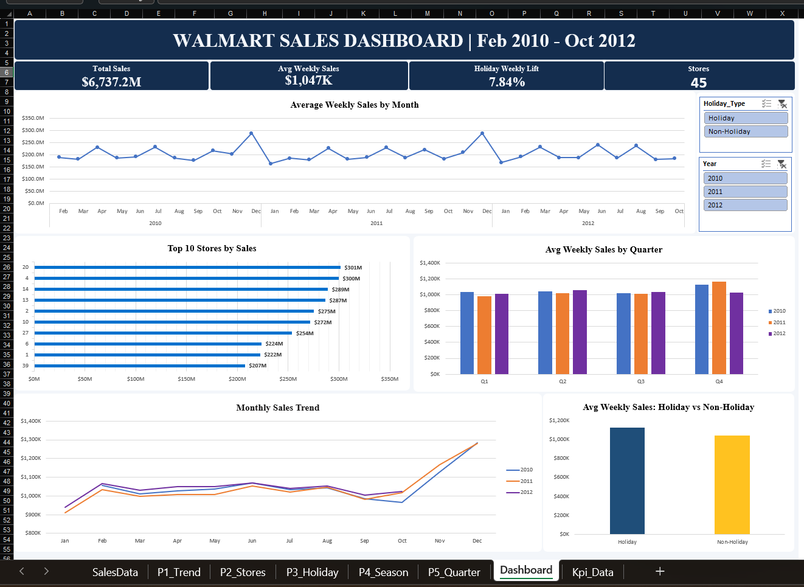

# Walmart Sales Dashboard

## Project Overview
An interactive Excel dashboard analyzing Walmart sales data from February 2010 to October 2012. The dashboard highlights sales trends, store performance, quarterly comparisons, and holiday sales impact.

## Dashboard Preview

## Key Insights
- Total sales: $6.74 billion
- Average weekly sales: $1.047 million
- Holiday weekly sales lift: 7.84%
- Stores analyzed: 45

## Dashboard Features
- Monthly sales trend by year
- Top 10 stores by sales
- Average weekly sales by quarter
- Holiday vs. non-holiday sales comparison
- Interactive Year and Holiday Type slicers

## Tools Used
- Microsoft Excel
- PivotTables and PivotCharts
- Slicers
- Excel formulas
- Data visualization

## Files
- `Walmart_Sales_Dashboard.xlsx` — Interactive Excel dashboard
- `dashboard.png` — Dashboard screenshot

## Dataset
Walmart sales data covering February 2010 to October 2012.

## Author
Prakash Jha
